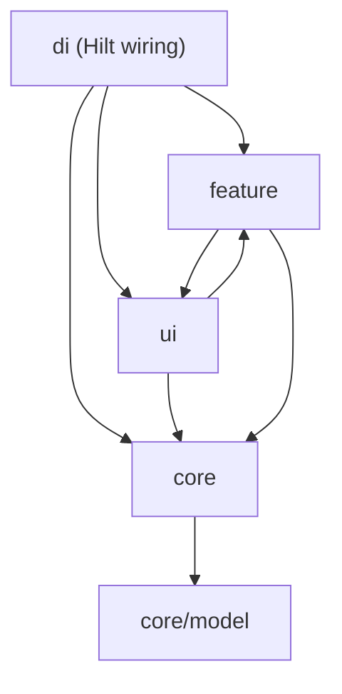
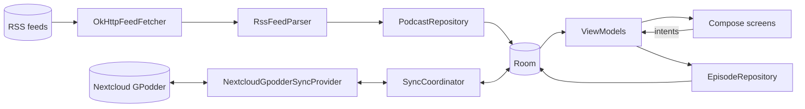
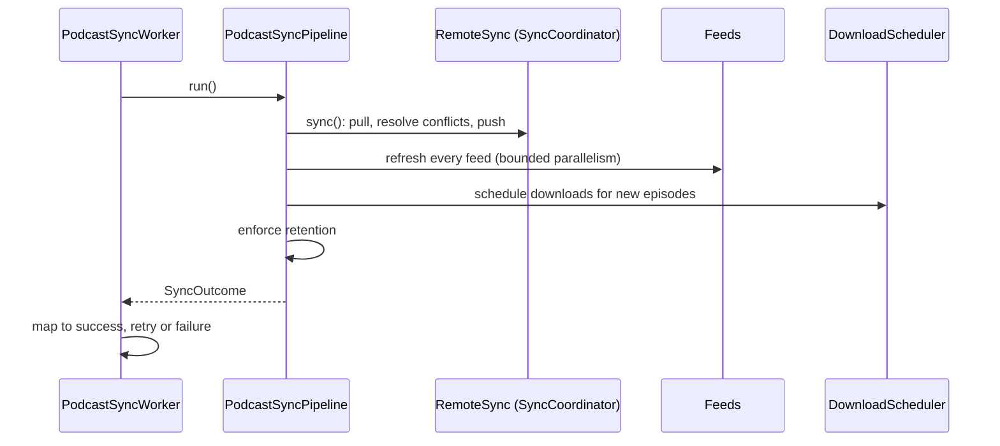
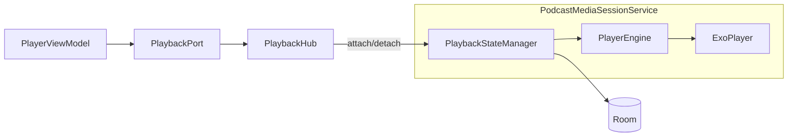

# Architecture

Sonora is a single-module Android app (`app/`) written in Kotlin. The UI is Jetpack Compose with
Material 3 Expressive, state lives in Room, and background work runs on WorkManager. Dependency
injection is Hilt. This document describes the boundaries and main flows; it deliberately does not
list classes, since the code is the reference for those. The reasons behind the main design
choices are recorded in [adr/](adr/README.md).

## Layers

```
org.sonora
├── ui/        Shell and shared Compose pieces: SonoraRoot (navigation), theme, reusable components
├── feature/   One package per screen: Screen (Compose) + ViewModel + feature-specific helpers
├── core/      Domain rules and infrastructure, with no UI
│   ├── database   Room entities, DAOs, repositories, TransactionRunner
│   ├── parser     Streaming RSS and OPML parsing
│   ├── network    OkHttp/Retrofit clients, HTTPS policy, Nextcloud login flow, directory search APIs
│   ├── sync       SyncCoordinator (pull, resolve, push), PodcastSyncPipeline (the background run)
│   ├── download   EpisodeDownloadManager, RetentionPlanner, eviction notices
│   ├── media      PlaybackStateManager, PlayerEngine, Media3 session service, PlaybackHub, play queue
│   ├── work       WorkManager workers and schedulers
│   ├── security   SecretStore (Android Keystore)
│   └── model      Plain data types shared across core
└── di/        AppModule: the Hilt graph that wires everything together
```

Dependencies point downwards:



- `feature` and `ui` depend on `core`; `core` does not depend on them.
- `ui` (the navigation shell and shared components) and `feature` (the screens) reference each
  other: the shell hosts every screen, and screens use the shared components and theme.
- **Known exceptions:** three `core` classes import `feature.settings`:
  `PodcastMediaSessionService` and `NextcloudRemoteSync` use `AppSettings`, and `PodcastSyncWorker`
  uses `SettingsStore`. Settings are stored by `feature/settings` but read by background code, so
  they sit on the boundary. Moving the settings interfaces into `core` would remove the exception.

## Data flow

Room is the single source of truth. Screens never talk to the network; background work and
user actions write to Room, and ViewModels expose what they read from it as `StateFlow`s.



Local changes (played, position, subscriptions) are written to Room and recorded in a sync queue in
the same transaction, so they are pushed to the server on the next sync and never lost if a push fails.

## Subsystems

### Feed parsing and the network
- `RssFeedParser` and `OpmlParser` stream from an `InputStream` using `XmlPullParser` and never
  hold a whole document as a string. The parser factory is injected, and parsers are built through
  `newHardenedParser` (`core/parser/XmlSupport.kt`) to block XXE.
- HTTPS is the default. `isTransportAllowed` rejects cleartext unless the user opts in, and
  `withTransportPolicy` adds `HttpsRedirectInterceptor` so an `https` to `http` redirect is rewritten
  to `https` rather than followed in cleartext. Playback and downloads apply the same policy via
  `upgradedToHttps`, and artwork requests are upgraded by a Coil interceptor (`HttpsUpgradeInterceptor`).
- Directory search (Apple, PodcastIndex) sits behind `DirectorySearch`; the Nextcloud login uses
  Login Flow v2, so the app never sees the user's password.
- Before the user types anything, Discover shows `DirectorySuggestions`: `ChartSuggestions` takes
  Apple's UK top-podcasts chart first and a smaller US tail after it (`ChartSuggestions.DEFAULT_SLOTS`),
  de-duplicated by feed URL. The chart only names shows, so `ApplePodcastChartProvider` looks them up to
  find their feeds. No API key is needed, and a failure just leaves the list empty. The charts are
  fetched in parallel, and `CachingSuggestions` keeps the last answer (6 hours, in `PrefsSuggestionStore`)
  so the tab opens with it instantly; `SonoraApp` prefetches at start-up so it is usually fresh too.

### Background sync
`PodcastSyncWorker` (WorkManager, periodic or on demand) runs `PodcastSyncPipeline.run()`:



Each step is isolated, so one failing never stops the others. The remote step runs first so
subscriptions it adds are refreshed in the same run, and pull precedes push so latest-timestamp-wins
conflict resolution works. Network calls stay outside database transactions, and reconciling
subscriptions and episode diffs is transactional (`TransactionRunner`). `SyncOutcome.toWorkOutcome`
decides whether to retry: flaky single feeds are tolerated, a lost server or total connectivity loss
retries (up to a limit), and rejected credentials fail without retrying.

### Playback
Playback is owned by a foreground Media3 service, not by any screen:



- `PlaybackStateManager` holds the playback rules (source selection, progress persistence, speed,
  silence skipping, sleep timer, generating `PLAY` actions for sync). It talks to the player only
  through the small `PlayerEngine` interface, which is why it is unit-testable on the JVM.
- `PlaybackHub` is a process-wide handle that lets ViewModels observe and drive the manager that
  lives inside the service, waiting briefly if the service has not started yet. ViewModels depend on
  the `PlaybackPort` interface, not on the hub.
- The manager is not thread-safe; it must be called from the dispatcher that owns the player (Main).
- The `PlayQueue` ("Queue") never contains the episode that is playing: starting an episode
  removes it, and finishing one starts the head. `next()` skips to the head. `previous()` restarts the
  episode if it is more than 3 seconds in; otherwise it goes back to the last episode played and puts
  the current one back at the head of the queue, so `next()` returns to it. That "last played" list is
  an in-memory history (50 entries) owned by the manager, so it is lost when the service is destroyed.
  The session's `ForwardingPlayer` maps Media3's seek-to-previous/next onto these, so the notification,
  lock screen and Bluetooth controls behave like the in-app buttons. Next is only advertised while the
  queue is non-empty, and the player re-announces its available commands whenever the queue changes.
- Queue edits are plain `PlayQueue` operations: `enqueue` (add to end), `enqueueNext` (play next),
  `move`, `remove`, `replaceAll`. Undo is just `replaceAll` with the previous order, which the
  Queue view model hands to the screen in `EpisodesEvent.QueueChanged`. Reordering is drag on
  `QueueDragHandle` (via `ReorderState` in `ui/components/QueueReorder.kt`) or the "Move up/down"
  accessibility actions on the same handle; clearing asks for confirmation first.

### Downloads and retention
`EpisodeDownloadManager` downloads enclosures to `*.part` files (resumable via HTTP `Range`) and
updates Room. `DownloadEpisodeWorker` runs it under WorkManager constraints (unmetered, charging).
`RetentionPlanner` is a pure function that picks what to evict under the keep-per-podcast and
storage limits (played before unplayed, older before newer, never the episode in use);
`EvictionNotices` tells the user afterwards.

### Settings and secrets
`AppSettings` implements `SettingsStore` (and the theme and discovery-credential interfaces) over
SharedPreferences. Secrets, such as the Nextcloud app password, go through `SecretStore`, backed by
the Android Keystore.

## UI

- `SonoraRoot` hosts a type-safe Navigation Compose graph (`LibraryRoute`, `EpisodesRoute`,
  `DiscoverRoute`, `DownloadsRoute`, `SettingsRoute`, `PodcastRoute(podcastId)`), adapts the
  navigation chrome to window size, and hosts the mini player, which expands into the full player.
- Each feature follows the same shape: a `@HiltViewModel` exposes immutable UI state as a
  `StateFlow` and accepts user actions as methods or `Intent` types, and a stateless-ish Composable
  renders it. ViewModels read DAOs and repositories directly; there is no separate use-case layer.
- Theme colours come from the playing episode's artwork (`ui/theme/ArtworkColors.kt`) via
  `MaterialExpressiveTheme`.

## Dependency injection and testability

`di/AppModule` is the one place that constructs the object graph. The things most worth swapping in
tests are narrow interfaces rather than concrete classes: `PlayerEngine`, `PlaybackPort`,
`SyncProvider`, `FeedFetcher`, `RemoteSync`, `DownloadScheduler`, `DownloadCanceller`,
`DirectorySearch`, `SecretStore`, `EvictionNotices`, `TransactionRunner` and `SettingsStore`.
Time and dispatchers are injected too (`Clock`, `ioDispatcher`). That is what makes the test-first
workflow in [CLAUDE.md](../CLAUDE.md) practical: JUnit 5 with fakes (`Fakes.kt`), MockK, Turbine and
MockWebServer for the JVM tests, and Robolectric for Compose UI tests.

UI tests live in `src/sharedTest` and are compiled into both the JVM unit-test source set (run by
`./gradlew testDebugUnitTest` under Robolectric) and `androidTest` (`connectedDebugAndroidTest`).

Coverage comes from AGP's JaCoCo support (`createDebugUnitTestCoverageReport`). Robolectric loads classes
through its own classloader, so `app/build.gradle.kts` sets `isIncludeNoLocationClasses`; without it the
Room, Compose and preferences tests count for nothing. `verifyCoverage` enforces a line-coverage floor on hand-written code; Room, Hilt and Dagger output is excluded
(`generatedClass` in `app/build.gradle.kts`) so it cannot flatter the figure. The HTML report still lists it.
